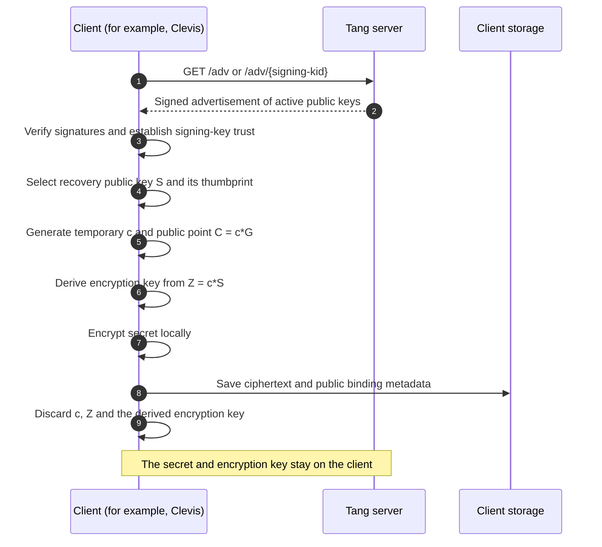
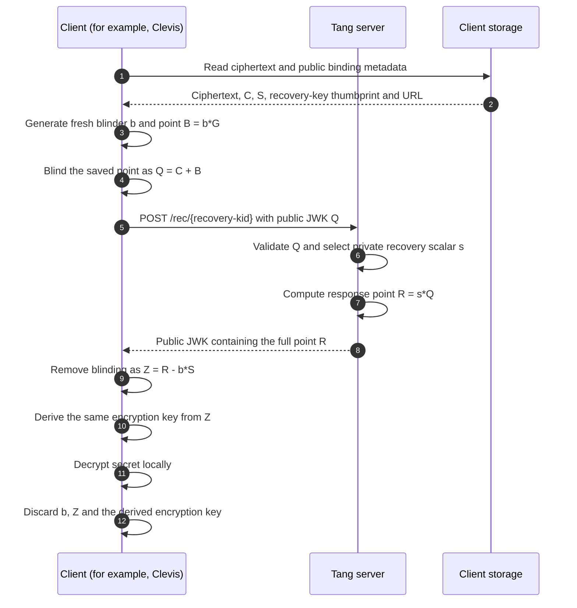

# Tangy Lib

## Description

Tangy-lib implements the Tang server protocol in Rust.
Your application supplies the HTTP server.

Clients use Tang to recover encrypted secrets when the server is available.
For example, Clevis can unlock a LUKS device when it can reach the Tang server.

See the [Tang project](https://github.com/latchset/tang) for more information.
Fraser Tweedale explains Clevis and Tang in this 2020 Linux Conference Australia talk:

[](https://www.youtube.com/watch?v=Dk6ZuydQt9I)

## How the Tang protocol works

Tang has two stages: bind a secret to a server, then recover the secret.
The client encrypts and decrypts the secret locally.
Tang publishes public keys and calculates a response from a blinded public point.
Key messages use JSON Web Keys (JWKs), a JSON format for keys.

### Bind a secret

The client verifies the advertisement signatures and establishes trust in a
signing key. It uses a configured thumbprint or an explicit decision to trust
the key on first use. The client selects a recovery key and encrypts the secret.
See [Clevis enrollment](https://github.com/latchset/clevis/blob/master/src/pins/tang/clevis-encrypt-tang).

The diagrams use these symbols:

| Symbol | Meaning |
| --- | --- |
| `G` | Curve base point. |
| `s` | Server private recovery scalar. |
| `S = s*G` | Server public recovery point. |
| `c` | Client temporary private scalar. |
| `C = c*G` | Client public point. |
| `Z = c*S` | Shared point used to derive the encryption key. |



The client saves `C`, the server public recovery key `S`, the recovery key
thumbprint and the server URL. Tang keeps its own keys.
It does not need a separate record for each client.
The client discards `c` and the derived key. Subsequent recovery requires
access to Tang.

### Recover a secret

For each recovery, the client generates a new random scalar `b` and point
`B = b*G`. It adds `B` to the saved point `C` before it contacts Tang.
See [Clevis recovery](https://github.com/latchset/clevis/blob/master/src/pins/tang/clevis-decrypt-tang).



The calculation removes the blinding:
`s*(C + b*G) - b*S = s*C = c*S`.
This gives the original shared point.
Tang receives `Q` and returns `R`. The client uses its private scalar `b`
to recover `Z`. The server keeps no state for the request.
See the [Tang protocol description](https://github.com/latchset/tang#binding).

Keep rotated recovery keys available while clients need them.
Existing bindings use their saved recovery key thumbprints.

### Use the library for HTTP requests

Your application supplies the HTTP endpoints.
Send the JSON strings returned by these methods:

| HTTP request | Library call |
| --- | --- |
| `GET /adv` | `tangy.adv(None)` |
| `GET /adv/{signing-kid}` | `tangy.adv(Some(signing_kid))` |
| `POST /rec/{recovery-kid}` with a public JWK body | `tangy.rec(recovery_kid, request_body)` |

## Installation

Add the library with Cargo:

``` bash
cargo add tangy-lib@1.0.0
```

Or add it to the dependencies in `Cargo.toml`:

``` toml
[dependencies]
tangy-lib = "1.0.0"
```

Use Rust **1.88.0** or later. CI tests cover Linux and Windows.

## Usage

Load keys once. Use the returned `TangyLib` for subsequent protocol requests.
Every active key set needs a private signing key and a private recovery key.

### Loading keys

**From a directory:** supply an existing directory with `.jwk` files.
The library generates and saves a new pair if the store has no key entries.
File names that start with `.` identify rotated keys.

```rust,no_run
use std::path::Path;
use tangy_lib::{KeySource, TangyLib};

let tangy = TangyLib::init(KeySource::LocalDir(Path::new("/var/lib/tang")))?;
# Ok::<(), tangy_lib::Error>(())
```

**From JWK strings:** supply a slice of private key strings.
Use existing keys or generate a pair as shown below.
This source does not write files.

```rust
use tangy_lib::{create_new_key_set, KeySource, TangyLib};

let keys = create_new_key_set()?;
let inputs: Vec<&str> = keys.iter().map(String::as_str).collect();
let tangy = TangyLib::init(KeySource::Vector(&inputs))?;
# Ok::<(), tangy_lib::Error>(())
```

**With rotated keys:** supply separate active and rotated key slices.
Rotated keys remain available for recovery. Advertisements omit these keys.

```rust
use tangy_lib::{KeySource, Result, TangyLib};

fn load_keys(active: &[&str], rotated: &[&str]) -> Result<TangyLib> {
    TangyLib::init(KeySource::KeySets { active, rotated })
}
```

### Using the loaded library

Get an advertisement or answer a recovery request:

```rust
# fn responses(tangy: &tangy_lib::TangyLib, recovery_kid: &str, request_body: &str) -> tangy_lib::Result<()> {
let advertisement = tangy.adv(None)?;
let recovery = tangy.rec(recovery_kid, request_body)?;
# Ok(())
# }
```

Both calls return JSON strings. Send them through your HTTP handler.
`recovery_kid` is the server recovery key thumbprint.
`request_body` is the client public JWK in JSON format.
Use `adv(Some(signing_kid))` to select a signing key.
The advertisement retains all active key signatures.
Errors return as `tangy_lib::Error`. The examples use `?` to return them to the caller.

See [key storage and rotation](#key-storage-and-rotation) for storage requirements.
See [MIGRATING.md](MIGRATING.md) for validation rules and API changes in 1.0.0.

## Key storage and rotation

Use an existing directory. Keep a backup of its keys.
The library generates and saves a pair only if the store has no key entries.
Invalid or incomplete stores return errors.
Start only one process on an empty store.

Unix files use mode `0440`, which permits owner and group read access.
Windows files inherit directory access control lists (ACLs).
Set the directory permissions before initialization.

To rotate keys:

1. Stop the service and all processes that can initialize the store.
2. Make a secure backup of the key directory.
3. Install a new signing and recovery key pair with the required permissions.
4. Add `.` to the start of the old `.jwk` file names to mark them as rotated.
5. Validate the store with `TangyLib::init`.
6. Restart the service after validation succeeds.

Keep rotated recovery keys while clients need them.
Advertisements omit rotated keys. A selected rotated signing key can add a
signature to the advertisement. For new Clevis bindings, use the current
active signing key thumbprint.

See the [key storage guide][key-storage-guide] for the full procedure,
file permissions and limits on recovery after a crash.

## Testing

See [TESTING.md](TESTING.md) for Rust checks, Clevis interoperability, platform
coverage, dependency audits and fuzzing.

## Credits

The original authors of [Tang](https://github.com/latchset/tang) are [Latchset](https://github.com/latchset/). Tang is based on the [protocol described by Nathaniel McCallum and Robert Relyea](https://marc.info/?m=144173814525805).

## License

Choose the Apache-2.0 or MIT license.

## How to Contribute

Unless you explicitly state otherwise, any contribution intentionally submitted for inclusion in the work by you, as defined in the Apache-2.0 license, shall be dual licensed (Apache-2.0 and MIT), without any additional terms or conditions.

[key-storage-guide]: KEY_STORAGE.md
