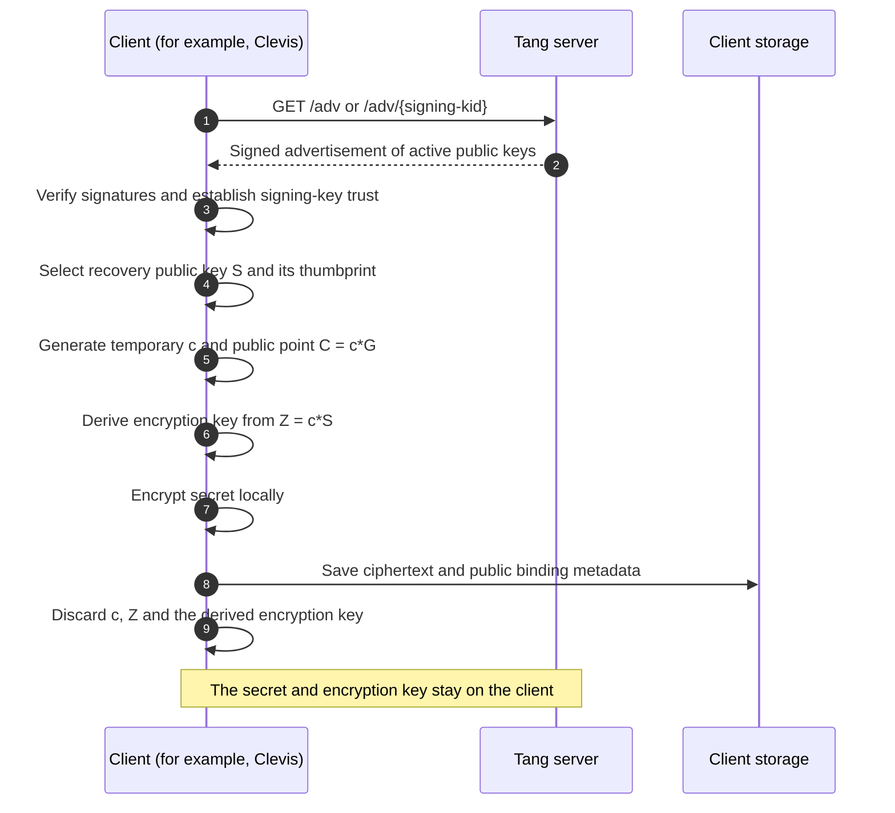
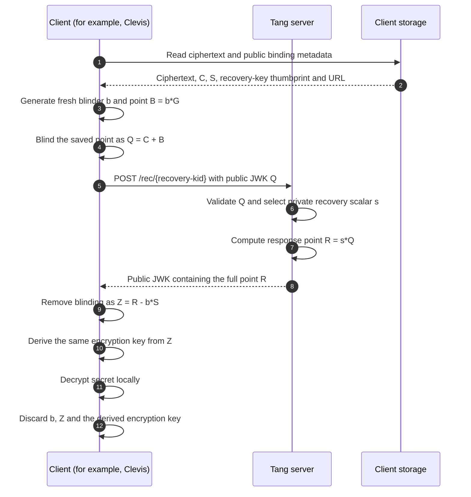

# Tangy Lib

## Description

Tangy-lib is a library implementation of the Tang server, written in Rust.

The Tang protocol allows clients to store secrets which can only be recovered when they have access to the Tang server. For example, the Clevis tools allow the automated decryption of LUKS partitions when the encrypted device is connected to the local network that Tang is accessible on.

See the [original Tang project](https://github.com/latchset/tang) for a complete description.

Fraser Tweedale's 2020 Linux Conference Australia talk on "Clevis and Tang: securing your secrets at rest" is a great resource:

[](https://www.youtube.com/watch?v=Dk6ZuydQt9I)

## How the Tang protocol works

Tang has two stages: binding a secret to a server, then recovering it later with
that server's help. The client encrypts and decrypts the secret locally. Tang
publishes its public keys and performs a blinded elliptic-curve calculation
during recovery. Key messages use JSON Web Keys (JWKs), a JavaScript Object
Notation (JSON) format.

### Binding a secret

The client first verifies the advertisement's signatures and establishes trust
in its signing key, using a configured thumbprint or an explicit decision to
trust it on first use. It selects an advertised recovery key and encrypts the
secret locally, as in [Clevis enrollment](https://github.com/latchset/clevis/blob/master/src/pins/tang/clevis-encrypt-tang).

In the diagrams, `G` is the curve's base point. Tang's private recovery scalar is
`s`, and its advertised public point is `S = s*G`. The client's temporary private
scalar is `c`, with public point `C = c*G`. The shared point `Z = c*S` is input
to key derivation; the resulting symmetric key encrypts the secret.



The saved binding metadata includes `C`, the server's public recovery key `S`,
its recovery-key thumbprint and the server URL. Tang keeps its own persistent
keys; it needs no per-client enrollment record. Discarding `c` and the derived
key makes subsequent recovery depend on access to Tang.

### Recovering the secret

For each recovery, the client creates a fresh random blinding scalar `b` and
public point `B = b*G`. It adds `B` to the saved point `C` before contacting Tang.
This follows [Clevis recovery](https://github.com/latchset/clevis/blob/master/src/pins/tang/clevis-decrypt-tang).



The blinding cancels because `s*(C + b*G) - b*S = s*C = c*S`, reproducing the
original shared point. Tang receives the blinded point `Q` and returns `R`;
the client uses its private `b` to recover `Z`. The server retains no per-request
state. See [Tang's protocol description](https://github.com/latchset/tang#binding)
for the underlying exchange. Keeping a rotated recovery key available lets
existing bindings continue to recover using their saved recovery-key thumbprint.

### Mapping the exchange to this library

The application hosting `TangyLib` supplies the HTTP endpoints and sends the
JSON strings returned by these methods:

| HTTP request | Library call |
| --- | --- |
| `GET /adv` | `tangy.adv(None)` |
| `GET /adv/{signing-kid}` | `tangy.adv(Some(signing_kid))` |
| `POST /rec/{recovery-kid}` with a public JWK body | `tangy.rec(recovery_kid, request_body)` |

## Installation

Installation via cargo:

``` bash
cargo add tangy-lib
```

Or directly using in the dependencies section of Cargo.toml:

``` toml
[dependencies]
tangy-lib = "0.2"
```

Requires Rust **1.88.0** or newer. CI covers Linux and Windows.

## Usage

Load a key source once, then reuse the returned `TangyLib` for protocol requests.
Every active key set needs a private signing key and a private recovery key.

### Loading keys

**From a directory:** load `.jwk` files from an existing directory. An empty
store generates and saves a new pair; dot-prefixed filenames identify rotated keys.

```rust,no_run
use std::path::Path;
use tangy_lib::{KeySource, TangyLib};

let tangy = TangyLib::init(KeySource::LocalDir(Path::new("/var/lib/tang")))?;
# Ok::<(), tangy_lib::Error>(())
```

**From JWK strings:** pass a slice of private key strings. You can supply your
own keys or generate a pair as below. This source does not write files.

```rust
use tangy_lib::{create_new_key_set, KeySource, TangyLib};

let keys = create_new_key_set()?;
let inputs: Vec<&str> = keys.iter().map(String::as_str).collect();
let tangy = TangyLib::init(KeySource::Vector(&inputs))?;
# Ok::<(), tangy_lib::Error>(())
```

**With rotated keys:** supply separate slices when older keys must remain
available for recovery without being advertised.

```rust
use tangy_lib::{KeySource, Result, TangyLib};

fn load_keys(active: &[&str], rotated: &[&str]) -> Result<TangyLib> {
    TangyLib::init(KeySource::KeySets { active, rotated })
}
```

### Using the loaded library

Get the advertisement or answer a client's recovery request:

```rust
# fn responses(tangy: &tangy_lib::TangyLib, recovery_kid: &str, request_body: &str) -> tangy_lib::Result<()> {
let advertisement = tangy.adv(None)?;
let recovery = tangy.rec(recovery_kid, request_body)?;
# Ok(())
# }
```

Both calls return JSON strings for your HTTP handler to send. `recovery_kid` is
the server recovery key's thumbprint; `request_body` is the client's public JWK
JSON. Use `adv(Some(signing_kid))` to select a signing key explicitly. Failures
return `tangy_lib::Error`, propagated here with `?`.

See [key storage and rotation](#key-storage-and-rotation) for persistence details
and [MIGRATING.md](MIGRATING.md) for validation rules and the 0.2 error/API changes.

## Key storage and rotation

Use an existing directory and keep its keys backed up. An empty store generates
and saves a key pair; invalid or incomplete stores return errors. Only one process
should initialize an empty store at a time. Unix files use mode `0440` (owner and
group read); Windows inherits the directory's access control lists.

To rotate keys:

1. Stop the service and back up the key directory.
2. Install a new signing/recovery pair, then prefix the old `.jwk` filenames
   with `.` to mark them rotated.
3. Validate the store with `TangyLib::init`, then restart the service.

Keep rotated keys while clients still depend on them. They remain usable for
recovery and are omitted from advertisements. New Clevis bindings should use
the current signing-key thumbprint.

See the [key storage guide][key-storage-guide] for the full rotation procedure, permissions
and crash-recovery guarantees.

## Testing

See [TESTING.md](TESTING.md) for Rust checks, Clevis interoperability, platform
coverage, dependency audits and fuzzing.

## Credits

The original authors of [Tang](https://github.com/latchset/tang) are [Latchset](https://github.com/latchset/). Tang is based on the [protocol described by Nathaniel McCallum and Robert Relyea](https://marc.info/?m=144173814525805).


## License

Apache-2.0 or MIT - you decide!

## How to Contribute

Unless you explicitly state otherwise, any contribution intentionally submitted for inclusion in the work by you, as defined in the Apache-2.0 license, shall be dual licensed (Apache-2.0 and MIT), without any additional terms or conditions.

[key-storage-guide]: KEY_STORAGE.md
